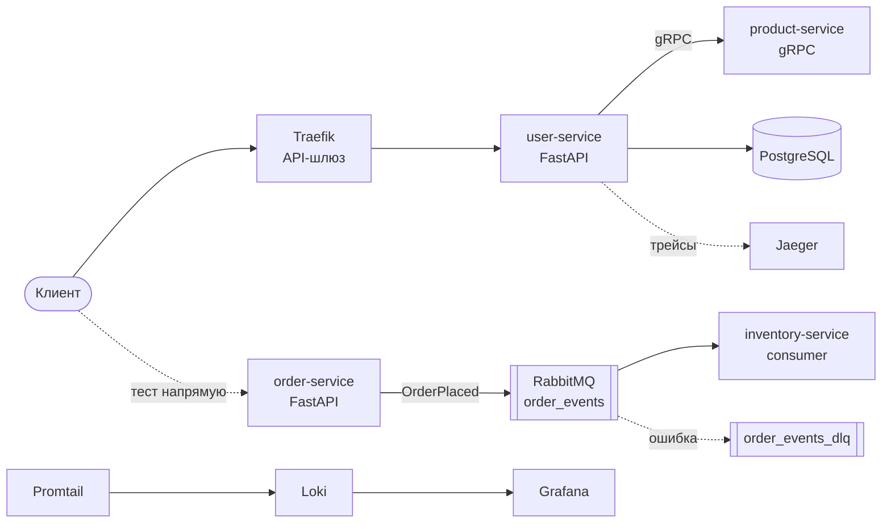

# FastAPI Microservices Architecture

Учебный проект интернет-магазина **fast-store** на микросервисах FastAPI.
Код написан по плейлисту [FastAPI Microservices Architecture](https://www.youtube.com/playlist?list=PLdtwawCR2QjlCvbu2WJ-8EiJNHmJuprvT).
Один коммит соответствует одному дню курса.

## Что внутри

- **uv workspace** — монорепозиторий: все сервисы в одном репо, у каждого свои зависимости.
- **gRPC + Protobuf** — быстрая синхронная связь между `user-service` и `product-service`.
- **Traefik** — API-шлюз, единая точка входа. Внутренние сервисы снаружи не видны.
- **JWT** — stateless-аутентификация: любой сервис проверяет токен без похода в БД.
- **RabbitMQ** — событийная архитектура: заказ публикуется в очередь, склад его обрабатывает.
- **Dead Letter Queue** — сообщения с ошибкой не теряются, а уходят в отдельную очередь.
- **OpenTelemetry + Jaeger** — распределённая трассировка запросов.
- **Promtail + Loki + Grafana** — логи всех контейнеров в одном месте.
- **Liveness / Readiness** — проверки здоровья и healthcheck в Docker.
- **Kubernetes** — Deployment и Service для `user-service`, масштабирование.
- **GitHub Actions** — тесты и сборка Docker-образа на каждый пуш в `main`.

## Архитектура



## Сервисы

| Сервис | Роль | Доступ |
|---|---|---|
| `user-service` | Пользователи, логин, JWT, покупки через gRPC | через Traefik: `/users`, `/login`, `/docs` |
| `product-service` | gRPC-сервер товаров | только внутри сети |
| `order-service` | Принимает заказ и публикует событие | `localhost:8002` |
| `inventory-service` | Слушает очередь и списывает остаток | `localhost:8003` |

## Быстрый старт

Нужны [Docker](https://www.docker.com/) и [uv](https://github.com/astral-sh/uv).

```bash
docker compose up --build
```

Если порт 80 занят, задай свой:

```bash
GATEWAY_PORT=8088 TRAEFIK_DASHBOARD_PORT=8089 docker compose up --build
```

### Адреса

| Что | URL | Логин |
|---|---|---|
| Swagger (через шлюз) | http://localhost/docs | — |
| Traefik dashboard | http://localhost:8080 | — |
| Order service | http://localhost:8002/docs | — |
| Inventory service | http://localhost:8003/docs | — |
| RabbitMQ | http://localhost:15672 | `guest` / `guest` |
| Jaeger | http://localhost:16686 | — |
| Grafana | http://localhost:3000 | `admin` / `admin` |

### Пример сценария

```bash
# 1. Создать пользователя
curl -X POST localhost/users/ -H 'content-type: application/json' \
  -d '{"name":"John","email":"john@example.com","password":"secret"}'

# 2. Получить токен
curl -X POST localhost/login -H 'content-type: application/json' \
  -d '{"name":"","email":"john@example.com","password":"secret"}'

# 3. Покупка: user-service сходит в product-service по gRPC
curl localhost/users/1/purchases/99 -H "Authorization: Bearer <token>"

# 4. Заказ: событие уйдёт в RabbitMQ, склад спишет остаток
curl -X POST "localhost:8002/orders/?product_id=99&user_id=1"
curl localhost:8003/inventory/99

# 5. Товар 999 имитирует сбой: сообщение попадёт в order_events_dlq
curl -X POST "localhost:8002/orders/?product_id=999&user_id=1"
```

## Локальная разработка

```bash
uv sync --all-packages
uv run --package user-service fastapi dev services/user-service/main.py --port 8001
```

Тесты:

```bash
cd services/user-service
uv run pytest
```

Сгенерировать gRPC-код после правки `protos/product.proto`:

```bash
for s in product-service user-service; do
  uv run python -m grpc_tools.protoc -Iprotos \
    --python_out=services/$s --grpc_python_out=services/$s protos/product.proto
done
```

## Kubernetes

```bash
docker build -t user-service:latest -f services/user-service/Dockerfile .
kubectl apply -f k8s/user-api.yaml
kubectl get pods

# Масштабирование
kubectl scale deployment user-service-deployment --replicas=10
```

Для minikube сначала загрузи образ: `minikube image load user-service:latest`.

## Структура

```
.
├── compose.yaml                 # Вся инфраструктура для локального запуска
├── protos/product.proto         # gRPC-контракт
├── shared/jwt_utils.py          # Общая проверка JWT
├── services/
│   ├── user-service/
│   ├── product-service/
│   ├── order-service/
│   └── inventory-service/
├── k8s/user-api.yaml            # Deployment + Service
├── promtail-config.yaml
├── grafana/provisioning/        # Источник данных Loki подключается сам
└── .github/workflows/ci.yaml
```

## План курса

| День | Тема |
|---|---|
| 1 | Монолит и микросервисы (теория) |
| 2 | uv workspace и первый сервис |
| 3 | SQLModel и первые эндпоинты |
| 4 | Docker multi-stage и PostgreSQL |
| 5 | gRPC и Protobuf |
| 6 | API-шлюз Traefik и CORS |
| 7 | JWT-аутентификация |
| 8 | RabbitMQ и событийная архитектура |
| 9 | Saga: inventory-service слушает события |
| 10 | Dead Letter Queue |
| 11 | OpenTelemetry и Jaeger |
| 12 | Grafana + Loki: централизованные логи |
| 13 | Liveness и Readiness пробы |
| 14 | Деплой в Kubernetes |
| 15 | CI/CD на GitHub Actions |
| 16 | Масштабирование в Kubernetes |

## Важно

Это учебный проект. Пароли (`password`, `guest`, `admin`) и JWT-ключ по умолчанию
захардкожены для простоты. В продакшене бери их из переменных окружения или секретов.
JWT-ключ переопределяется через `JWT_SECRET_KEY`.
